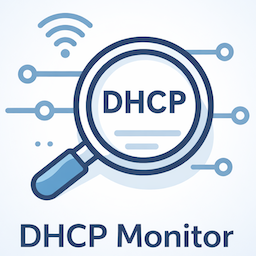
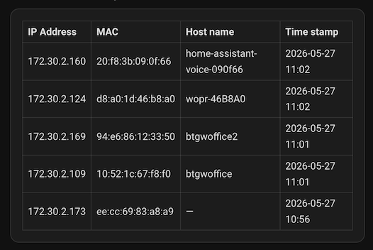

# DHCP Monitor for Home Assistant

[](https://github.com/custom-components/hacs)

This Home Assistant integration hooks into the [Home Assistant DHCP discovery](https://www.home-assistant.io/integrations/dhcp/)
integration to monitor IP address assignments on your network. 
It provides 5 sensors showing information about the last 5 detected devices.



## Features
- Detects new IP address assignments via DHCP discovery.
- 5 sensors: `sensor.dhcp_device_1` to `sensor.dhcp_device_5`.
- Attributes include: IP address, MAC address, and Hostname.

## Requirements

DHCP Monitor needs Home Assistant 2025.5 or newer, with the [DHCP discovery](https://www.home-assistant.io/integrations/dhcp/) integration enabled (it is part of `default_config`).

> [!IMPORTANT]
> Home Assistant has no public API for listening to DHCP packets, so DHCP Monitor relies on an internal helper of the dhcp integration (`async_register_dhcp_callback_internal`). Home Assistant can change or remove that helper in any release. If that happens, DHCP Monitor fails to load after the upgrade until it is updated. Check this repository for a new release before reporting a problem.

## Installation

### Marketplace (recommended)

DHCP Monitor can be installed from the Home Assistant Marketplace (Home Assistant 2026.11 or newer). It isn't in the default store yet, so add this repository as a custom repository first:

1. Go to **Settings** > **Marketplace**
2. Open the menu ⋮, select **Custom repositories**, enter `https://github.com/jonnybergdahl/HomeAssistant_Dhcp_Monitor_Integration`, pick type **Integration** and select **Add**
3. Search for **DHCP Monitor** and open it
4. Select **Install**, check the version, and select **Install** again

Or click the button. It offers to add the repository as a custom repository and then opens DHCP Monitor in the Marketplace:

[](https://my.home-assistant.io/redirect/hacs_repository/?owner=jonnybergdahl&category=Integration&repository=HomeAssistant_Dhcp_Monitor_Integration)

No restart is needed. Home Assistant goes straight to the setup flow described below.

> On Home Assistant 2025.5 to 2026.10, install DHCP Monitor through HACS instead: add this repository under **HACS** > ⋮ > **Custom repositories** (type **Integration**), search for **DHCP Monitor**, click **Download**, then restart Home Assistant.

### Manual

1. Copy the `custom_components/dhcp_monitor` folder into your Home Assistant `config/custom_components/` directory
2. Restart Home Assistant

## Setup

Click the button to add DHCP Monitor to Home Assistant.

[](https://my.home-assistant.io/redirect/config_flow_start/?domain=dhcp_monitor)

You can also set it up manually:

1. Go to **Settings** > **Devices & services** > **Add integration**
2. Search for **DHCP Monitor**
3. Click **Submit** when it asks if you want to set up DHCP Monitor

> DHCP Monitor has nothing to configure, so there is no **Configure** action. Only one instance can be set up.

## Usage
The integration will start listening for DHCP discovery events as soon as it is configured.
The sensors will update their state with the IP address of the detected device.
Other details like MAC address and Hostname are available in the sensor attributes.

You can use it with a Markdown card to display the info like this. 



Use the following yaml. 

```yaml
type: markdown
content: >-
IP Address | MAC | Host name | Time stamp
--- | --- | --- | ---






{{ ip if ip not in ['unknown', 'unavailable'] else '—' }} | {{ mac if mac else '—' }} | {{ host if host else '—' }} | {{ last.strftime('%Y-%m-%d %H:%M') if last else '—' }}

```

## Debug Logging
To enable debug logging for this integration, add the following to your `configuration.yaml`:

```yaml
logger:
  default: info
  logs:
    custom_components.dhcp_monitor: debug
```

## Logging
When debug logging is enabled, you should see the following keywords in your logs:
- `Registering DHCP sniffer callback`: Confirmation that the integration is listening for DHCP packets via the internal dhcp helper.
- `DHCP packet received: IP=...`: Detailed information after processing a captured DHCP packet.
- `Sensor DHCP Device X received update signal from dispatcher`: Confirmation that sensors are responding to new data.